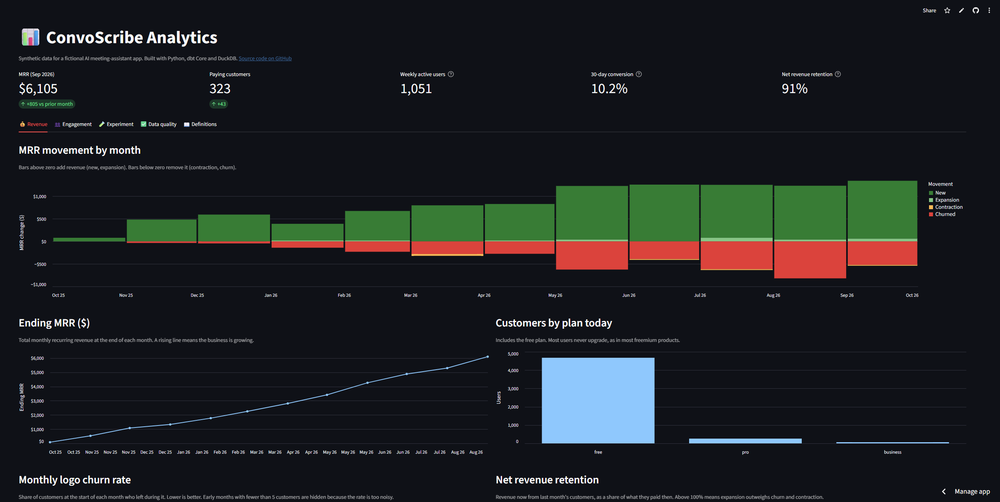
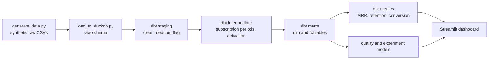
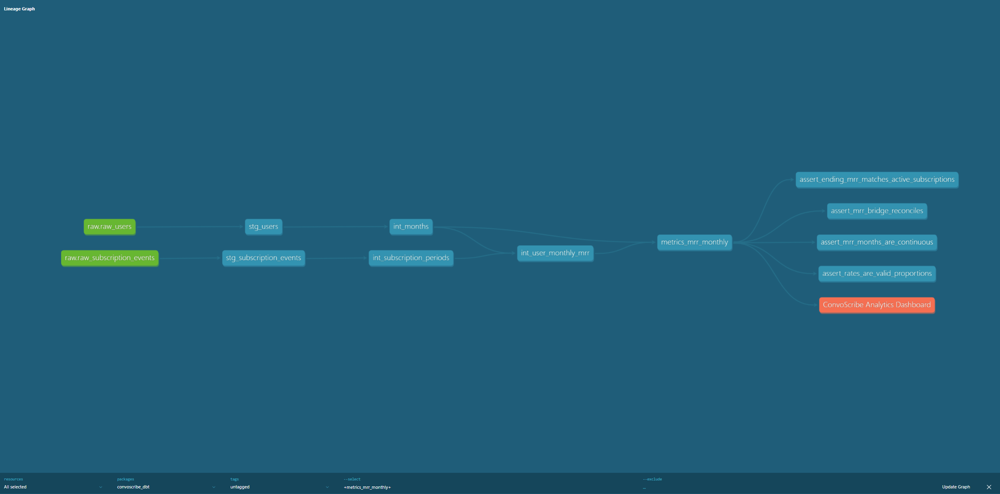

# ConvoScribe Analytics

An analytics engineering project: a dbt + DuckDB data platform for a fictional freemium AI meeting-notes app, with governed metrics, automated data quality checks, an A/B test readout, and a live dashboard.

### 👉 [Live dashboard](https://convoscribe-analytics-srimukhi.streamlit.app/)

The data is **synthetic**, generated by code in this repo, so no real company or user data is involved.



## What this project demonstrates

| Skill | Where to look |
|---|---|
| Layered dbt modeling (staging, intermediate, marts) | `convoscribe_dbt/models/` |
| Source-of-truth tables (`dim_users`, `dim_workspaces`, `fct_meetings`, `fct_subscriptions`, `fct_daily_activity`) | `models/marts/core/` |
| Governed metrics: weekly active users, activation, conversion, MRR bridge, churn, net revenue retention, cohort retention | `models/marts/metrics/`, `docs/metric_dictionary.md` |
| Data quality: 119 automated dbt tests, reconciliation tests, anomaly detection | `models/marts/quality/`, `tests/` |
| Experimentation: lift, z-test, confidence interval, sample ratio check | `models/marts/experiments/` |
| Logging standards | `docs/tracking_plan.md` |
| Python for data generation, loading and orchestration | `data_generation/`, `run_pipeline.py` |
| A published dashboard on a free host | `dashboard/` |

**Stack:** Python, SQL, dbt Core, DuckDB, Streamlit, Git/GitHub.

## Architecture



The dbt lineage graph, ending at the dashboard:



## The business questions

1. How much recurring revenue are we making, and why does it change month to month?
2. Which new users become active, and do they become paying customers?
3. Are users sticking around after they sign up?
4. Did the new upgrade prompt actually improve conversion?
5. Can we trust the data behind these answers?

## Key findings (from the simulated data)

These describe the simulation, not real user behaviour. The patterns exist because the data generator builds them in.

- **Early engagement separates payers from non-payers.** Among users who had a full 14-day window, 17.4% of activated users (3+ meetings in 14 days) went on to a paid plan, versus 5.5% of users who did not activate, about 3x. Early activation is the lever worth testing.
- **Revenue grew 2.7x in six months.** MRR went from $2,255 in March (117 paying customers) to $4,265 in June (227) and $6,105 in September (323).
- **Growth comes from new customers, not existing ones.** Net revenue retention improved from 82% to 88% to 91% over the same months but stayed below 100%, and monthly logo churn eased from 13.5% to 10%.
- **The business plan carries outsized revenue.** 63 business customers (19.5% of payers) generate 36% of MRR ($2,205 of $6,105). The 260 pro customers generate the other 64%.
- **Retention drops sharply between months 1 and 3.** 71% of a signup cohort has a meeting in the signup month, 70% in month 1, 33% in month 3, and 14% by month 6. The first three months are the window to target.
- **The new upgrade prompt worked.** Fourteen-day paid conversion rose from 6.6% (control) to 10.1% (treatment): +3.5 percentage points (95% CI +1.5 to +5.5), about a 53% relative lift. The result is significant at the 5% level, with no sample ratio mismatch.

## How the pipeline protects data quality

- **Raw data is never edited.** It is loaded as-is, and dbt cleans it downstream.
- **Flag first, then decide.** Staging flags bad rows (zero-length meetings, unknown users) instead of deleting them. The marts exclude them, and a reconciliation test proves that staged rows equal included rows plus excluded rows.
- **Maturity-aware rates.** Activation and conversion use only users who have had the full measurement window, so recent weeks are not understated.
- **A fixed cutoff date.** Everything uses a `data_as_of` variable instead of today's date, so results are reproducible.
- **Definitions in one place.** Metric windows live in `dbt_project.yml` variables, and the metric dictionary documents each definition and its edge cases.
- **Revenue reconciliation.** The MRR bridge must balance every month, and ending MRR must equal the sum of active subscription prices: two independent calculations of the same number.
- **Anomaly detection checked against a planted failure.** A same-weekday z-score detector scores daily meetings, active users and signups, and a test proves it flags the logging outage injected on 2026-03-18.
- **A data quality scorecard** reports every issue found and fixed: duplicates, missing emails, invalid durations, unknown users, inconsistent event names, and late-arriving rows.

## Project structure

```text
convoscribe-analytics/
  README.md
  run_pipeline.py              one command: generate, load, dbt build, export
  requirements.txt
  data_generation/             synthetic data generator and DuckDB loader
  convoscribe_dbt/
    models/
      staging/                 clean and standardize raw tables
      intermediate/            subscription periods, activation, MRR by user-month
      marts/
        core/                  source-of-truth dimensions and facts
        metrics/               governed business metrics
        quality/               freshness, anomaly detection, scorecard
        experiments/           A/B test readout
    tests/                     custom SQL tests
    macros/                    custom generic test, schema naming
  dashboard/                   Streamlit app and exported data
  docs/                        tracking plan, metric dictionary, images
```

## Run it yourself

Requires Python 3.10 to 3.13.

```powershell
git clone https://github.com/srimukhi7/convoscribe-analytics.git
cd convoscribe-analytics
python -m venv .venv
.\.venv\Scripts\Activate.ps1
pip install -r requirements.txt

python run_pipeline.py                # generate, load, dbt build, export
streamlit run dashboard/app.py        # open the dashboard locally

cd convoscribe_dbt
dbt docs generate
dbt docs serve                        # browse model docs and lineage
```

On macOS or Linux, activate the environment with `source .venv/bin/activate`.

## Design decisions and trade-offs

- **DuckDB** keeps the project free and runnable anywhere. dbt makes the warehouse swappable.
- **The hosted dashboard reads exported CSVs** because the free host cannot reach a local database. In production it would query the warehouse directly.
- **Same-weekday baselines** for anomaly detection, because weekends are naturally quiet. A single rolling average would flag every weekend.
- **Two-condition anomaly rule** (a large z-score and a large percentage change) to avoid alert fatigue.
- **Month-end MRR snapshots** mean a customer who starts and cancels within one month never appears in MRR. This is documented in the metric dictionary.

## Limitations and next steps

- The data is synthetic, so findings describe the simulation, not real user behaviour.
- The pipeline is run manually. Scheduling it with an orchestrator such as Airflow is a natural next step (not built).
- Running the same models on a cloud warehouse such as BigQuery or Snowflake is another (not built).

## Author

Srimukhi Sridhar Paidikondala · [GitHub](https://github.com/srimukhi7)